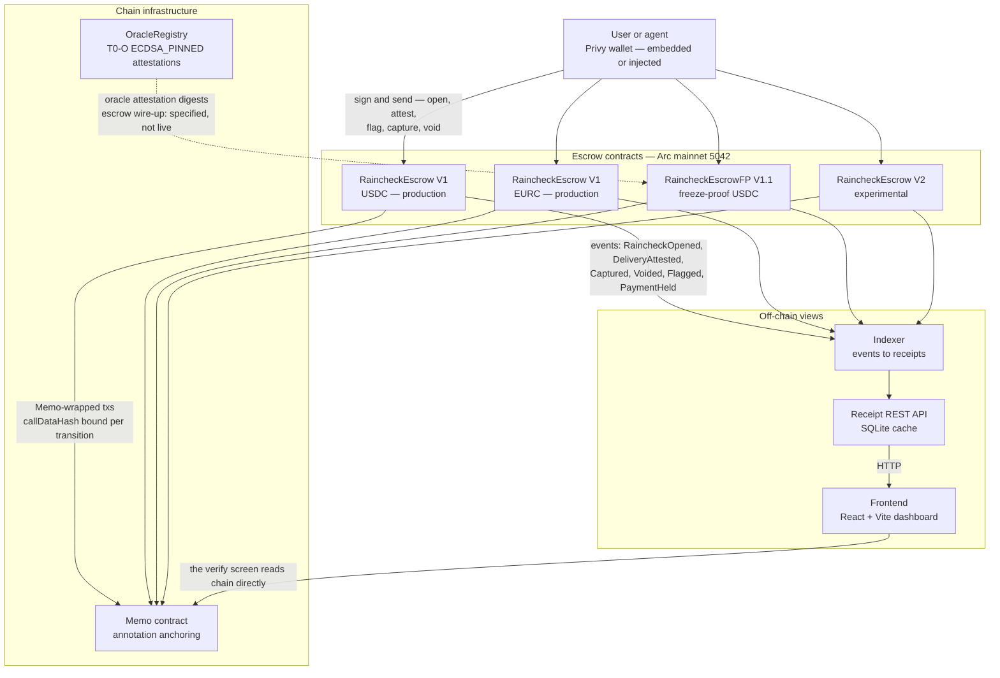
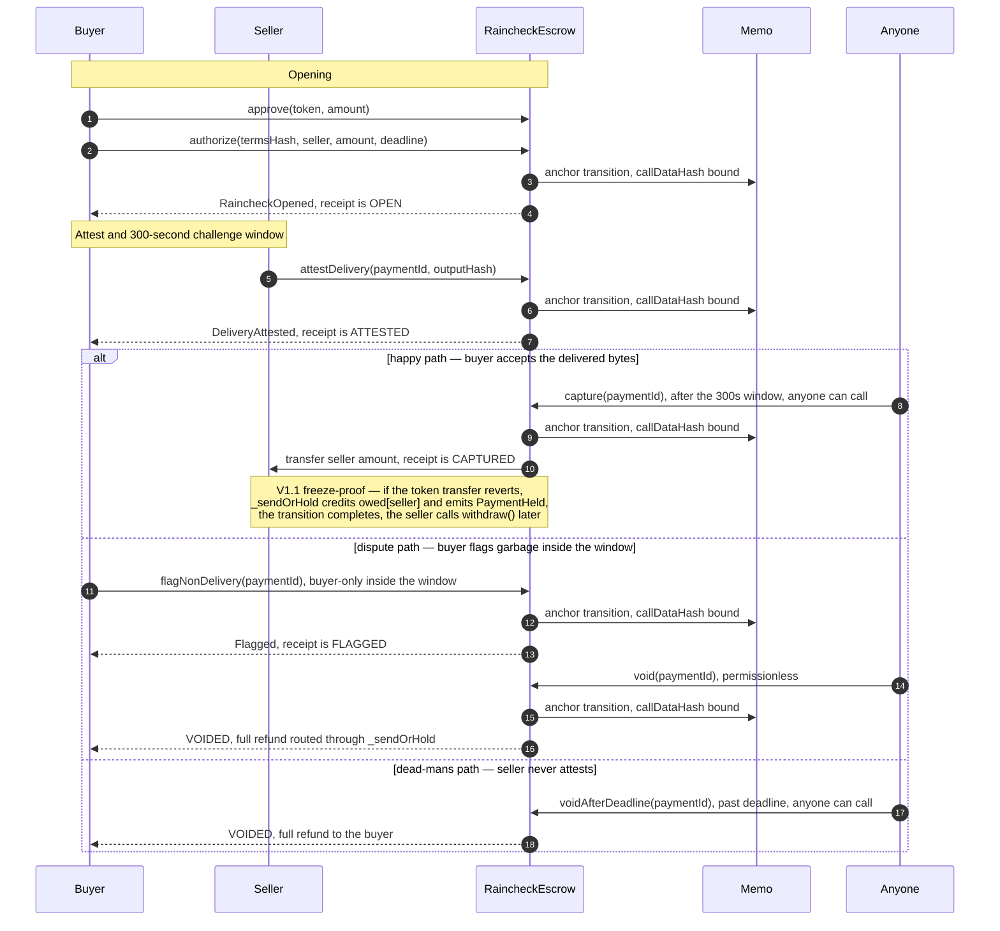

# RAINCHECK

**Delivery-attested receipts for agent commerce.** Pay for agent work: money is held in escrow, released when delivery is proven on-chain, refunded when it isn't. Every state transition is anchored through the on-chain Memo contract, so each receipt is portable, third-party-verifiable evidence — not a database row.

> No demo mode. No mock data. No fake success. Every button that looks executable executes on-chain, or it is disabled with the reason and the next action shown. If a control can't be backed by a real transaction, it isn't in the product.

---

## Contents

1. [The story](#the-story)
2. [Architecture](#architecture)
3. [Receipt lifecycle](#receipt-lifecycle)
4. [Repo layout](#repo-layout)
5. [Mainnet contracts](#mainnet-contracts)
6. [Mainnet proof ledger](#mainnet-proof-ledger)
7. [Run locally](#run-locally)
8. [Deploy](#deploy)
9. [Wallet setup (Privy)](#wallet-setup-privy)
10. [Environment variables](#environment-variables)
11. [Tests](#tests)
12. [Honest gaps](#honest-gaps)
13. [What you have to trust](#what-you-have-to-trust)
14. [Links](#links)

---

## The story

An agent pays for an API call, gets HTTP 400 or garbage bytes back, and has nothing to show its principal — the money is gone and no machine-verifiable proof exists that anything was delivered. RAINCHECK is a delivery-attested escrow that closes exactly this gap: the buyer locks USDC against signed terms, the seller attests delivery with the SHA-256 hash of the exact delivered bytes, a 300-second challenge window lets the buyer flag garbage, and then *anyone* can finalize — `capture` pays the seller, `void` refunds the buyer in full. Every step is wrapped through the on-chain Memo contract, so the receipt is anchored, queryable, and verifiable by any third party (marketplaces, auditors, trust-scorers) from chain state alone.

The happy path (deliver → attest → capture → seller paid) and the dispute path (garbage → flag → void → full refund) are both proven on Arc mainnet with real signed transactions, recorded in the [proof ledger](#mainnet-proof-ledger) below. So is the path nobody wants to think about: the V1.1 freeze-proof escrow survives a frozen payout token — the state transition completes instead of reverting, the credit is recorded on-chain (`owed`), and a permissionless `withdraw` recovers the funds once the token is unfrozen. And a real external-oracle trigger is captured: a third-party courier signature verified by `ecrecover` against a pinned on-chain key.

This README is written for the two audiences that matter: **judges**, who can verify every claim against an explorer link or a Sourcify match below, and **integrators**, who get exact addresses, exact commands, and the exact trust assumptions. Anything specified but not yet proven says so in plain words — see [Honest gaps](#honest-gaps).

---

## Architecture

```
                         ┌──────────────────────────────────────────────┐
                         │               ARC MAINNET (5042)             │
                         │                                              │
   ┌──────────┐          │   ┌───────────────────┐   ┌──────────────┐   │
   │   User   │          │   │ RaincheckEscrow   │   │ Memo         │   │
   │  + Privy │ sign ───▶│   │ 0x97f233…580CB5  │──▶│ 0x5294E9…    │   │
   │  wallet  │          │   │ (holds USDC)      │anchor│ e505 (annotation)││
   └────┬─────┘          │   └─────────┬─────────┘   └──────────────┘   │
        │               │             │ events (RaincheckOpened,       │
        │               └─────────────┼─────────────── DeliveryAttested,│
        ▼                             │               Captured, Voided) │
   ┌────────────┐                     ▼                                 │
   │  Frontend  │          ┌─────────────────────┐    ┌──────────────┐   │
   │  React +   │◀─────────│ Indexer (Node)      │───▶│ REST API     │   │
   │  Vite      │  HTTP    │ events → receipts   │    │ (SQLite)     │   │
   └────────────┘          └─────────────────────┘    └──────────────┘   │
```

The same picture as a flowchart, with the full contract set:



**The chain is the source of truth. Everything else is a view of it.**

- **RaincheckEscrow (V1)** holds USDC or EURC per `paymentId`. State machine: OPEN → ATTESTED → CAPTURED, or ATTESTED → FLAGGED → VOIDED, or OPEN → VOIDED (deadline). `capture`, `void`, `voidAfterDeadline` are permissionless — no keeper, no liveness dependency, funds can never trap.
- **RaincheckEscrowFP (V1.1)** is V1 with exactly two deltas: all payouts route through `_sendOrHold` (a failed token transfer credits `owed[]` and emits `PaymentHeld` instead of reverting the state transition), and a permissionless `withdraw()` re-pays or re-holds. Same state machine, same 300s window, otherwise byte-behavior identical.
- **RaincheckEscrowV2** is the experimental delta instance: 7-parameter `authorize` (adds `policyRef`/`fundingRef`), per-seller dispute accounting (`disputes=1` on void). Experimental, dust-only, not for integration.
- **OracleRegistry** is the T0-O ECDSA_PINNED tier: an attestation store, never holds funds. Issuers are pinned on-chain; attestations are `ecrecover`-checked raw signatures over `keccak256("raincheck:5042:oracle:" ‖ paymentId ‖ outputHash)`. The escrow wire-up (ORACLE_ONLY/ORACLE_PREFERRED capture gates) is specified, not live.
- **Memo** (`0x5294E9…e505`, existing infrastructure we use but never redeploy) wraps every state-transition transaction: execution and anchoring in one tx, with `callDataHash` cryptographically binding the annotation to the exact calldata.
- **Indexer** is a cache: it consumes the escrow events (via `eth_getLogs`, with Circle Contracts API monitors if keys are set) and rebuilds canonical receipt JSON per `paymentId`. Every receipt it serves must be re-derivable from chain logs + Memo anchors alone.
- **Frontend** never invents state. Every displayed status is read from chain or the event cache; every action button maps to exactly one on-chain transaction.

---

## Receipt lifecycle

The state machine is specified **by name**, never by number (don't hardcode status ordinals off-chain — read them from the Sourcify-verified source of the deployment you integrate with): OPEN → ATTESTED → CAPTURED; ATTESTED → FLAGGED → VOIDED; OPEN → VOIDED on deadline.



Three things the diagram hides on purpose, because they matter:

1. **Memo anchoring is per transition.** Every `authorize`, `attestDelivery`, `flagNonDelivery`, `capture`, `void`, `voidAfterDeadline` that flows through the UI is wrapped: `BeforeMemo` → inner call → `Memo`, with `callDataHash` binding the annotation to the exact calldata. The `/verify` screen recomputes the receipt hash client-side against the on-chain anchor — no trust in the indexer.
2. **Capture before attestation reverts.** `capture` on a never-attested receipt reverts (`not ATTESTED`, status 0) on both token instances — proven on mainnet, funds stay locked, receipt stays OPEN. See PROOFS.md §3.1 and §3.2.
3. **V1.1 never traps funds.** On V1, a payout-token freeze bricks the receipt (the transfer reverts, the state transition fails). On V1.1, `try/catch` around the token transfer turns a revert into an `owed[]` credit plus a `PaymentHeld` event; `withdraw()` is permissionless and re-holds while still frozen. Proven on mainnet with a pausable test token — see PROOFS.md §2.2 and the [honest caveat](#honest-gaps).

---

## Repo layout

```
raincheck-build/
├── README.md            # this file
├── PROOFS.md            # judges' verification file — every hash, every tx, PROVEN vs SPECIFIED
├── HISTORY.md           # build history (what was done, in what order)
├── MOCK-HUNT.md         # the hunt that killed every mock — nothing fake ships
├── contracts/           # Foundry — Solidity sources, deploy scripts, forge tests
│   ├── src/             # RaincheckEscrow.sol (V1), RaincheckEscrowV2.sol, RaincheckEscrowFP.sol (V1.1), OracleRegistry.sol (T0-O), PausableTestToken.sol (test-only)
│   ├── test/            # forge tests — 60/60 passing (RaincheckCore, RaincheckEdge, RaincheckV2, OracleRegistry, RaincheckEscrowFP)
│   ├── script/          # Deploy.s.sol, DeployOracle.s.sol
│   ├── deployments/     # arc-5042.json / arc-5042-fp.json / arc-5042-oracle.json / arc-mainnet.json (verified addresses, Sourcify refs)
│   ├── broadcast/       # forge broadcast artifacts (tx provenance)
│   ├── memo/            # Memo-contract integration helpers
│   └── DEPLOY.md        # deployment runbook
├── backend/             # Node/Express + SQLite — event indexer + Receipt REST API
│   ├── src/api/         # REST routes, app, chainStore, types
│   ├── src/indexer/     # poller, store, matcher, config, selftest
│   ├── src/receipts/    # canonical receipt builder (jcs), types
│   ├── src/webhooks/    # Circle Contracts API monitors (optional) + HMAC receiver
│   ├── test/            # backend tests — 57/57 passing
│   └── render.yaml      # Render blueprint (free web service, no disk)
├── frontend/            # React + Vite + Tailwind + Privy — dashboard
│   ├── src/pages/       # LandingPage, VerifyPage, dashboard pages
│   ├── src/components/  # dashboard, landing, ui, token, BridgePanel, GetEurcPanel
│   ├── src/lib/         # capabilities gates, memo log, simulate (eth_call pre-sim), export (PDF print), lifi, cctp
│   ├── MOCK-HUNT.md     # the hunt that killed every mock — nothing fake ships
│   └── vercel.json      # Vercel build config (npm run build → dist)
├── evidence/            # the JSONs behind PROOFS.md — qa2-e2e-results.json, e2e-eurc.json, e2e-v2/, lifi-swap.json
└── scripts/             # shared ops scripts (e2e runners: run-e2e-eurc.mjs, run-e2e-v2.mjs, reconstruct-e2e-v2.mjs, preflight.mjs)
```

Full build specification: [`raincheck-build-bible.md`](../your_files/raincheck-build-bible.md) — thesis, contract specs, test-evidence ledger, UI spec, wallet decision. It is the source of truth for *why* things are built the way they are.

---

## Mainnet contracts

All on **Arc mainnet (chain ID 5042)**. Every address, deploy tx, and block below is copied character-for-character from [PROOFS.md](PROOFS.md) §1, which is evidence-authoritative. Verify everything on the explorer before trusting it.

| Instance | Address | Deploy tx | Block | Sourcify | Purpose |
|---|---|---|---|---|---|
| **V1 USDC (production)** | [`0x97f233865ae84DC7475F6D7CA404930654580CB5`](https://explorer.arc.io/address/0x97f233865ae84DC7475F6D7CA404930654580CB5) | [`0xebd2e3…3aa51`](https://explorer.arc.io/tx/0xebd2e3fbbf805ba36fe0c1173f655b10aa769fd6809ccdfec5e61cef5213aa51) | 25956323 | [`exact_match`](https://sourcify.dev/server/v2/contract/5042/0x97f233865ae84DC7475F6D7CA404930654580CB5) | Production escrow, USDC. 300s challenge window. The one the app indexes. |
| **V1 EURC (production)** | [`0x3ceba2fbeb27162bfc4888f6b61e48bd359c1e0a`](https://explorer.arc.io/address/0x3ceba2fbeb27162bfc4888f6b61e48bd359c1e0a) | [`0x34f724…4094`](https://explorer.arc.io/tx/0x34f7240f5c074fa082ad4e6b672d0fbd2542792459e5f09d51ee2ebc586a4094) | 25962288 | [`exact_match`](https://sourcify.dev/server/v2/contract/5042/0x3ceba2fbeb27162bfc4888f6b61e48bd359c1e0a) | Production escrow, EURC. Same verified source, one instance per token. |
| **V2 (experimental)** | [`0x3795b865f7fc84a14ab60456be9fc6dd0cb56f0c`](https://explorer.arc.io/address/0x3795b865f7fc84a14ab60456be9fc6dd0cb56f0c) | [`0x046f17…dcae`](https://explorer.arc.io/tx/0x046f1744296e87e006ce1a48318cad992ac3d4cd3a22b5302db26f0b3d7cdcae) | 25962342 | [`exact_match`](https://sourcify.dev/server/v2/contract/5042/0x3795b865f7fc84a14ab60456be9fc6dd0cb56f0c) | Experimental delta instance (7-param authorize, disputes accounting). Dust only — **do not integrate**. |
| **OracleRegistry (T0-O ECDSA_PINNED)** | [`0x61412688aAF14F8A0e94C6665933E5DFA84e405A`](https://explorer.arc.io/address/0x61412688aAF14F8A0e94C6665933E5DFA84e405A) | [`0x1879d4…6a45d67d`](https://explorer.arc.io/tx/0x1879d4fd35ebbbc71c933cb6d13626ca60783335c520e44bcfb6a54e6a45d67d) | 25995772 | [`exact_match`](https://sourcify.dev/server/v2/contract/5042/0x61412688aAF14F8A0e94C6665933E5DFA84e405A) | Third-party oracle attestation store. **Never holds funds.** |
| **RaincheckEscrowFP V1.1 (freeze-proof, USDC)** | [`0x54F05A5214d99cA458d142bA9E2f0CB77c1B2470`](https://explorer.arc.io/address/0x54F05A5214d99cA458d142bA9E2f0CB77c1B2470) | [`0x80295e…d0eb7c`](https://explorer.arc.io/tx/0x80295e4b498a9c46348bc4b55741a429e65bfb921d11b6517428a9ae50d0eb7c) | 25995933 | [`exact_match`](https://sourcify.dev/server/v2/contract/5042/0x54F05A5214d99cA458d142bA9E2f0CB77c1B2470) | Freeze-proof V1.1 on real USDC: `_sendOrHold` → `owed[]` + `PaymentHeld` + permissionless `withdraw()`. |
| **RaincheckEscrowFP V1.1 (freeze-proof, test-token)** | [`0x10F2F2f10Fd9F6820BC83dE48EF0D6720A173F29`](https://explorer.arc.io/address/0x10F2F2f10Fd9F6820BC83dE48EF0D6720A173F29) | [`0x1bbb6d…db4b3`](https://explorer.arc.io/tx/0x1bbb6dc9cc226b023a9f64e2137688ac8e890e01ac836ad30e4cc199251db4b3) | 25995942 | [`exact_match`](https://sourcify.dev/server/v2/contract/5042/0x10F2F2f10Fd9F6820BC83dE48EF0D6720A173F29) | Test instrument only — the instance that proved the freeze path against a pausable token. No economic value. |

On-chain checks passed on all six (per PROOFS.md §1): `challengeWindow()` = 300 (0x12c) on all four escrow instances; constructor token matches the token listed for the instance; non-empty runtime code; OracleRegistry `owner()` = deployer, `ROTATION_TIMELOCK()` = 259200; all deploy txs status 1.

**Reference tokens (third-party, not ours):**

| Token | Address | Notes |
|---|---|---|
| USDC (gas + payment token) | [`0x3600000000000000000000000000000000000000`](https://explorer.arc.io/address/0x3600000000000000000000000000000000000000) | Arc's gas token. 18 decimals on Arc. EIP-2612 `permit` is **not** supported — approvals go through `approve`. |
| EURC | [`0xbEf5f6d51CB62b58e6A8f77868681825C6fe21c1`](https://explorer.arc.io/address/0xbEf5f6d51CB62b58e6A8f77868681825C6fe21c1) | The checksum case shown here is the correct EIP-55 encoding of the same 20 bytes. |
| Memo (annotation infra) | [`0x5294E9927c3306DcBaDb03fe70b92e01cCede505`](https://explorer.arc.io/address/0x5294E9927c3306DcBaDb03fe70b92e01cCede505) | Existing infrastructure we use but never redeploy. Third-party — see "What you have to trust" §7. |
| PausableTestToken (test-only) | [`0x5A1166eC096e12C0C6187695F82B7F4b285389Df`](https://explorer.arc.io/address/0x5A1166eC096e12C0C6187695F82B7F4b285389Df) ([deploy tx](https://explorer.arc.io/tx/0xf20a03534c75413a66e708030d20a8574811be99aee5d01ecb3896cf2049945c)) | Sourcify exact_match. No economic value; exists only to prove the V1.1 freeze path. |

**Prior art.** The mechanism was first proven on a 60-second-window experiment instance, `0x41099436c5f18eA916B9ca3B835fdc4B5c758Deb` (deploy tx `0xacec97a227d2e3529f7e44018499f35f0177dfbf57dbffb7d403f4bfc6d88bee`, Sourcify exact_match). On it we proved the deliver half (attest → capture → seller paid) and, on a second instance `0x44357E99755705376627542509d8D2eabF02562F`, the void half (garbage → flag → void → full refund, txs in the build bible §6). The production build above is the same verified source with the spec 300s window. The T0-O **OIDC_RS256** tier and the **oracle→escrow wire-up** (`ORACLE_ONLY`/`ORACLE_PREFERRED` capture gates) are **specified, not yet deployed** — they are not claimed as live anywhere in this product. The T0-O **ECDSA_PINNED** tier *is* live (OracleRegistry above), as an attestation store only.

---

## Mainnet proof ledger

Everything below has a tx hash and an explorer link, or it is labeled specified-not-live. This table is a summary — the hashes live in [PROOFS.md](PROOFS.md) (judges' file), rebuilt from the JSONs in [`evidence/`](evidence/).

| Proof group | What was executed | Evidence |
|---|---|---|
| V1 USDC lifecycle | Happy (authorize → attest → capture → 0.01 USDC to seller), void (authorize → flag → void → full 0.01 USDC refund), and a **reverted** pre-attestation capture (`not ATTESTED`, funds stay locked) | PROOFS.md §3.1 — 7 dust txs |
| V1 EURC lifecycle | Same three flows in EURC (0.01 EURC): happy capture pays seller, void refunds buyer, pre-attestation capture reverts | PROOFS.md §3.2 — 6 dust txs |
| V2 experimental deltas | 7-param authorize with `policyRef` stored on-chain, full capture lifecycle, void records `disputes=1`, `voidAfterDeadline` refunds when the seller never attests, pre-attestation capture reverts | PROOFS.md §3.3 — 5 dust txs |
| LI.FI USDC→EURC swap | **0.5 USDC → ~0.448 EURC** executed live via Kyberswap through a LI.FI quote on Arc 5042 | PROOFS.md §3.4 — 2 txs |
| OracleRegistry T0-O ECDSA_PINNED | Owner registers a throwaway issuer key, a **real pinned-key signature** is attested on-chain (`ecrecover` matches), the key is revoked on-chain | PROOFS.md §2.1 — 3 txs |
| FP V1.1 happy path (real USDC) | authorize → attest → capture on `0x54F05A…B2470`: exactly 0.01 USDC to seller, `owed(seller)` = 0 — happy-path behavior unchanged from V1 | PROOFS.md §2.2 — 4 txs |
| FP V1.1 freeze path (test token) | Token paused → `void` **status 1, does not revert** → `PaymentHeld` + `owed(buyer)` = 10000 → unpause → permissionless `withdraw()` → buyer recovers +10000. Full recovery, nothing trapped. | PROOFS.md §2.2 — 9 txs, honest caveat in [Honest gaps](#honest-gaps) |
| External oracle trigger, end-to-end | One receipt (`0x25f4091f…38b58`) whose delivery digest was signed by a **real third-party courier key** and `ecrecover`-verified against the pinned on-chain issuer before `attestDelivery` + `capture` finalized it | PROOFS.md §2.3 — 5 txs |
| Foundry suite | 60/60 pass: 14 lifecycle + 13 edge/fuzz + 11 V2-delta + 13 oracle + 9 freeze-proof | PROOFS.md §2 |
| Off-chain suites | Backend 57/57, frontend 155/155 | PROOFS.md §4 |

Note on the verify page: a pre-existing bug made it report MISMATCH on **all** receipts (wrong Memo event layout); it was root-caused, fixed, and regression-tested — the verify path above is the corrected one.

---

## Run locally

### Prerequisites

- Node 20+, npm
- Foundry (`forge`, `cast`) — for contracts
- A wallet with a small amount of Arc USDC (gas) if you want to execute on mainnet — gas price observed ≈ 20 gwei; a full receipt lifecycle costs roughly 0.008–0.01 USDC

### Contracts

```bash
cd contracts
forge build        # compile (solc 0.8.24, optimizer OFF — part of the Sourcify exact_match profile)
forge test         # 60/60
```

### Backend (indexer + Receipt API)

```bash
cd backend
npm install
cp .env.example .env     # edit only if you need non-default public values
npm run build            # tsc — required before dev
npm run dev              # starts the API (default http://localhost:3000)
```

The indexer boots by scanning from `ESCROW_DEPLOY_BLOCK` (25956323) and `ESCROW_DEPLOY_BLOCK_EURC` (25962288), then follows events via `eth_getLogs` (and Circle Contracts API monitors if `CIRCLE_API_KEY` is set). On first run it backfills — give it a few minutes against mainnet. `npm run indexer` runs the indexer self-test.

### Frontend (dashboard)

```bash
cd frontend
npm install
cp .env.example .env     # set VITE_PRIVY_APP_ID; VITE_API_URL points at the backend
npm run dev              # http://localhost:5173
```

Open a receipt, walk the flow. On the detail page, every action button names the exact transaction it will send before your wallet prompts. Attest/flag/capture/void are Memo-wrapped, sent with manual gas limits (never `eth_estimateGas` — the Memo contract reverts under estimation). Action buttons also run an `eth_call` pre-send simulation so a revert shows up before you sign, not after.

---

## Deploy

### Frontend → Vercel

- Build command: `npm run build` (`tsc -b && vite build`), output directory: `dist`. Framework preset: Vite (see `frontend/vercel.json`).
- Environment variables (all public by design): `VITE_PRIVY_APP_ID` (public app ID), `VITE_API_URL` (the backend URL), `VITE_ESCROW_ADDRESS` / `VITE_ESCROW_ADDRESS_EURC` (verified addresses above), `VITE_RPC_URL`.
- Ship on a **custom domain from day one** — shared-hosting subdomains get flagged on domain reputation in some wallets (a benign report is "received," not "cleared").

### Backend → Render

`backend/render.yaml` is the blueprint (apply from the dashboard or `render blueprint apply` from the repo root):

- Instance type **Free** (`plan: free`). Root directory `backend/`. Build `npm ci && npm run build`; start `npm start`; health check `/health`.
- Set `FRONTEND_URL` to the frontend origin (CORS) in the Render dashboard. `RPC_URL`, both escrow addresses, and the deploy blocks are already in the blueprint.
- The free tier has no disk and the service sleeps when idle. `RAINCHECK_DB_PATH=/tmp/raincheck-index.db` is a cache only. After a cold start the indexer rebuilds it from chain; the dashboard shows what has been indexed so far, never invented rows.
- `WEBHOOK_SECRET` and `FRONTEND_URL` have `sync: false` — set them in the Render dashboard, never in a file.
- A fresh deploy backfills the index from the deploy blocks, so the dashboard is live without a data migration.

---

## Wallet setup (Privy)

The build bible picked **Privy** because the integration quirks on Arc are empirically documented with working workarounds — real teams have shipped this path, and the founder's own test wallets (MetaMask, Rabby) are covered by Privy's injected-connector path, so the tested flow and the shipped flow are the same thing.

1. Create an app at [privy.io](https://www.privy.io) and copy the **App ID** into `VITE_PRIVY_APP_ID`.
2. Login methods: **wallet (injected: MetaMask, Rabby, Coinbase Wallet) + email/SMS embedded wallets**. Embedded wallets on Arc are EOAs — they can sign everything RAINCHECK needs.
3. Add Arc mainnet as a custom chain:

```ts
const arcMainnet = {
  id: 5042,
  name: 'Arc',
  nativeCurrency: { name: 'USDC', symbol: 'USDC', decimals: 18 }, // gas-USDC is 18 decimals
  rpcUrls: { default: { http: ['https://rpc.mainnet.arc.io'] } },
  blockExplorers: { default: { name: 'Arc Explorer', url: 'https://explorer.arc.io' } },
};
```

Two Arc-specific workarounds are mandatory and already baked into the frontend:

- **`eth_signTransaction` + own-RPC broadcast.** `eth_sendTransaction` returns 401 on Arc. The app signs locally and broadcasts the raw transaction itself via `eth_sendRawTransaction` to `https://rpc.mainnet.arc.io`. Do not use `eth_sendTransaction` anywhere.
- **EIP-712 snake_case `primary_type`.** Privy's typed-data signing expects `primary_type` (snake_case), not `primaryType`. The terms-signing and attestation flows use the snake_case field.

Two chain facts the app assumes: Memo-wrapped transactions always use a **manual gas limit** (Memo reverts under `eth_call`/gas estimation); and **EIP-2612 `permit` is not supported on Arc USDC** — approvals go through `approve`, never `permit`.

---

## Environment variables

Public defaults live in the `.env.example` files. Copy them to `.env` for local overrides; **never commit a real `.env`, and never put private keys or API secrets in any committed file**. Rows marked **SECRET** must come from your platform secret store (Render / Vercel env), never from the repo.

**Backend** (`backend/.env.example`):

| Variable | SECRET? | Default / notes |
|---|---|---|
| `PORT` | no | `3000` |
| `RPC_URL` | no | `https://rpc.mainnet.arc.io` |
| `ESCROW_ADDRESS` | no | `0x97f233865ae84DC7475F6D7CA404930654580CB5` (V1 USDC production) |
| `ESCROW_DEPLOY_BLOCK` | no | `25956323` |
| `ESCROW_ADDRESS_EURC` | no | `0x3ceba2fbeb27162bfc4888f6b61e48bd359c1e0a` (V1 EURC production) |
| `ESCROW_DEPLOY_BLOCK_EURC` | no | `25962288` |
| `MEMO_ADDRESS` | no | `0x5294E9927c3306DcBaDb03fe70b92e01cCede505` (third-party infra) |
| `RAINCHECK_DB_PATH` | no | `/tmp/raincheck-index.db` on the free Render service (ephemeral cache, rebuilt from chain after sleep). Locally, any filesystem path |
| `FRONTEND_URL` | no | frontend origin, used for CORS |
| `WEBHOOK_SECRET` | **SECRET** | HMAC-SHA256 key for verifying webhook signatures. No value in the example file on purpose — generate with `node -e "console.log(require('crypto').randomBytes(32).toString('hex'))"` |
| `WEBHOOK_URL` | no | public URL the optional webhook receiver listens on |
| `CIRCLE_API_KEY` | **SECRET** (optional) | enables Circle Contracts API monitors; empty = `eth_getLogs` path only |
| `CIRCLE_WEBHOOK_SECRET` | **SECRET** (optional) | webhook signature verification for Circle monitors |
| `CIRCLE_ENTITY_SECRET` | **SECRET** (optional) | Circle entity secret for monitor setup |
| `CIRCLE_BLOCKCHAIN` | no (optional) | chain descriptor for Circle monitors |

**Frontend** (`frontend/.env.example`) — everything here is public by design; the bundle ships it:

| Variable | SECRET? | Notes |
|---|---|---|
| `VITE_PRIVY_APP_ID` | no | Privy public app ID. If unset, wallet connect is gracefully unavailable instead of crashing. |
| `VITE_API_URL` | no | backend base URL (`http://localhost:3000` for local dev) |
| `VITE_ESCROW_ADDRESS` | no | `0x97f233865ae84DC7475F6D7CA404930654580CB5` (V1 USDC production) |
| `VITE_ESCROW_ADDRESS_EURC` | no | `0x3ceba2fbeb27162bfc4888f6b61e48bd359c1e0a` (V1 EURC production) |
| `VITE_RPC_URL` | no | `https://rpc.mainnet.arc.io` |

---

## Tests

Counts below are the committed suites in this repo. If a number doesn't match, the suite changed — check it, don't trust this line.

| Suite | Command | Result |
|---|---|---|
| Contracts (Foundry) | `cd contracts && forge test` | **60/60** |
| Backend | `cd backend && npm test` | **57/57** |
| Frontend | `cd frontend && npm test` | **155/155** |

What the suites prove, and what they don't: unit coverage of the state machine (double-open reverts, seller-only attest, buyer-only flag inside the window, permissionless capture/void), the V2 deltas (`policyRef` storage, `disputes=1` on void, `voidAfterDeadline`), the oracle tier (wrong-key revert, revoked-issuer revert, 3-day rotation timelock, OIDC "not live" revert, registration guards), the freeze-proof path (frozen capture/void/voidAfterDeadline → `PaymentHeld` + `owed[]`; withdraw after unpause; re-hold while frozen; happy path unchanged), the indexer receipt builder against recorded mainnet logs, and the dashboard capability gates (a button only enables when role + state + chain time allow).

**Test counts are for the repo suites.** Mainnet execution evidence — real signed transactions with real USDC dust — lives in [PROOFS.md](PROOFS.md), referenced by tx hash, never reprinted as proof here. The T0-O OIDC tier has a Forge test matrix specified but **no tests running against a live deployment, because it isn't deployed**.

---

## Honest gaps

From PROOFS.md §5, in plain words:

1. **Third-party volume: zero.** All proofs are first-party dust. No real buyer/seller has used the product. The mechanism is proven; the market is not.
2. **The freeze was induced on a test token.** The V1.1 freeze path was proven on mainnet against `PausableTestToken` (no economic value) because a real-USDC freeze cannot be induced without Circle blacklisting an address. The exercised failure mode — token `transfer` reverts — is exactly what a frozen-USDC payout does at the EVM level; the contract cannot distinguish them. A real-USDC freeze remains unobserved.
3. **OIDC_RS256 tier: specified, not live.** Registration of OIDC issuers is allowed on the OracleRegistry (kind recorded honestly), but every verification path reverts `"OIDC not live"`. RS256 verification was never deployed; there are no mainnet txs for it.
4. **Oracle→escrow wire-up: specified, not live.** `OraclePolicy` modes (ORACLE_ONLY/ORACLE_PREFERRED) and oracle-gated capture are build-bible spec — no escrow contract consumes oracle attestations yet. The external-oracle receipt (PROOFS.md §2.3) was finalized through the normal seller path; the oracle attestation stands on-chain beside it, not as a gate.
5. **V2 is experimental.** The V2 contract is proven on mainnet but is experimental, dust-only, and marked **do not integrate**.
6. **In-app CCTP: guide only.** The bridge panel shows an honest path (EOA depositForBurn works; LI.FI swaps route live), but contract-initiated CCTP burns are chain-gated on Arc — proven with minimal test contracts. The panel never pretends otherwise.
7. **Circle Onramp Kit: mentioned as a fiat fallback only.** No integration was executed.

---

## What you have to trust

This section is on the front page on purpose. Read it before using the product.

1. **The chain is the source of truth; the indexer is a cache.** The API serves receipts rebuilt from contract events. It can be wrong, stale, or down — every receipt is re-derivable from chain logs + Memo anchors, and the `/verify` screen recomputes the receipt hash client-side against the on-chain anchor. If the API and the chain disagree, the chain wins.
2. **No backend custody.** The backend never holds funds, keys, or signing authority. USDC lives in the escrow contract; transactions are signed by the user's wallet. There is nothing to withdraw from us.
3. **Seller attestation is a claim, not proof.** `attestDelivery` records that the seller *says* specific bytes were delivered (committed by SHA-256). What makes the system work is the 300-second challenge window plus the permanent, anchored record — the buyer verifies the bytes match the claim before the window closes, and a false claim becomes public, permanent evidence.
4. **Delivery quality can't be hashed.** If the bytes match the claim but the work is subjectively bad, no cryptography settles that — the terms you signed are the contract, and you should write them precisely.
5. **You must watch the challenge window.** If the buyer doesn't inspect the delivery and flag garbage within 300 seconds, the seller can be paid. In ORACLE_ONLY mode (specified, not yet live), an oracle proof plus a short post-proof window replaces seller attestation — the oracle attests an *event*, not correctness, and the window exists for the semantic gap. The T0-O ECDSA_PINNED registry *is* live as an attestation store; nothing consumes it on-chain yet.
6. **Specified ≠ proven.** T0-O OIDC_RS256 attestation, the oracle→escrow wire-up, and the trust-stack deltas are fully specified and kill-gate-corrected — they are not deployed and not claimed as live. Anything on this page that is specified rather than proven says so in plain words.
7. **The Memo contract is infrastructure we use, not code we control.** Every transition is anchored through `0x5294E9…e505`. If that contract were ever upgraded or behaved differently, receipt anchoring would be affected — the escrow logic itself would not be, because the escrow functions stand alone without the wrapper.

---

## Links

- **Arc explorer:** https://explorer.arc.io
- **Production escrow (V1 USDC):** https://explorer.arc.io/address/0x97f233865ae84DC7475F6D7CA404930654580CB5
- **Production escrow (V1 EURC):** https://explorer.arc.io/address/0x3ceba2fbeb27162bfc4888f6b61e48bd359c1e0a
- **Freeze-proof escrow (V1.1 USDC):** https://explorer.arc.io/address/0x54F05A5214d99cA458d142bA9E2f0CB77c1B2470
- **OracleRegistry (T0-O ECDSA_PINNED):** https://explorer.arc.io/address/0x61412688aAF14F8A0e94C6665933E5DFA84e405A
- **V2 (experimental):** https://explorer.arc.io/address/0x3795b865f7fc84a14ab60456be9fc6dd0cb56f0c
- **Deploy transaction (V1 USDC):** https://explorer.arc.io/tx/0xebd2e3fbbf805ba36fe0c1173f655b10aa769fd6809ccdfec5e61cef5213aa51
- **Sourcify verification (exact_match):** https://sourcify.dev/server/v2/contract/5042/0x97f233865ae84DC7475F6D7CA404930654580CB5
- **Memo contract:** https://explorer.arc.io/address/0x5294E9927c3306DcBaDb03fe70b92e01cCede505
- **USDC:** https://explorer.arc.io/address/0x3600000000000000000000000000000000000000
- **EURC:** https://explorer.arc.io/address/0xbEf5f6d51CB62b58e6A8f77868681825C6fe21c1
- **Judges' verification file:** [PROOFS.md](PROOFS.md)
- **Repo:** https://github.com/mohamedwael201193/RAINCHECK-
- **Build bible (full spec + test-evidence ledger):** `../your_files/raincheck-build-bible.md`
